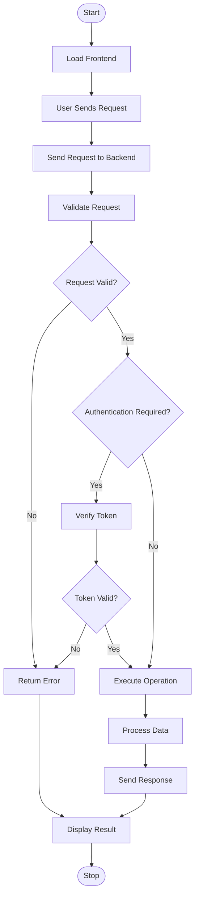
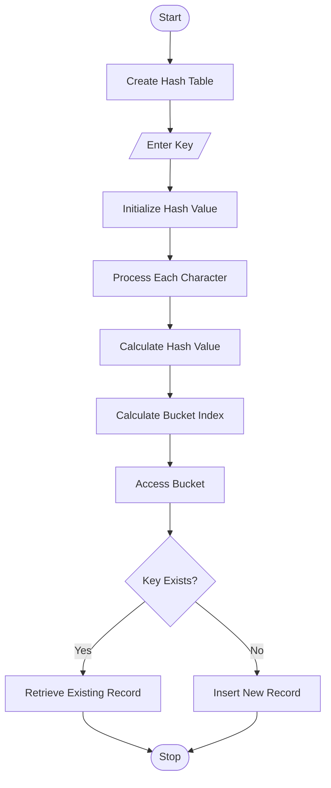
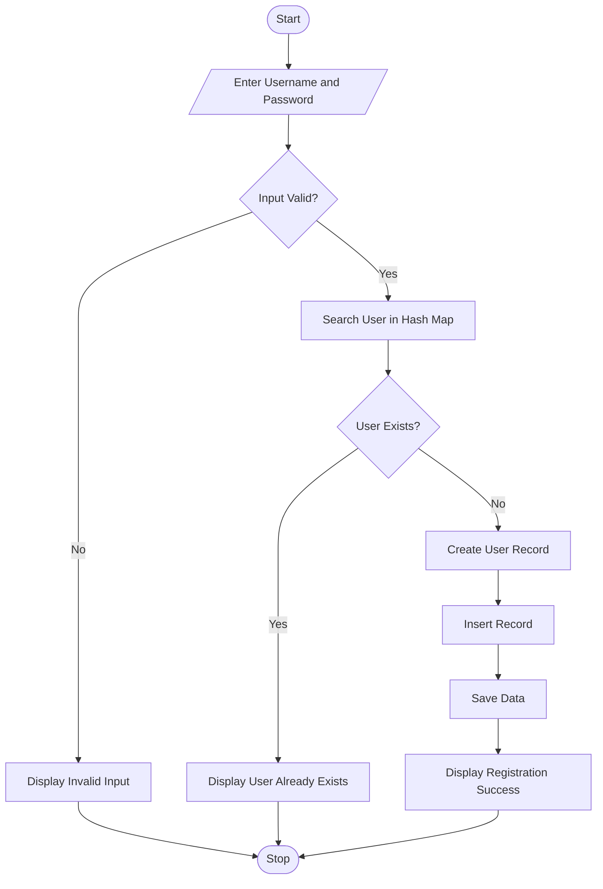
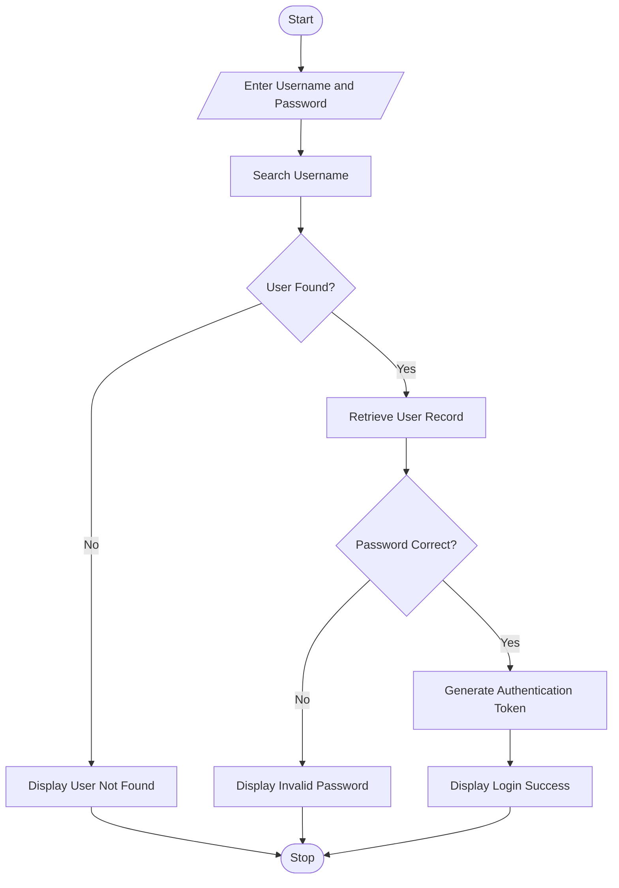
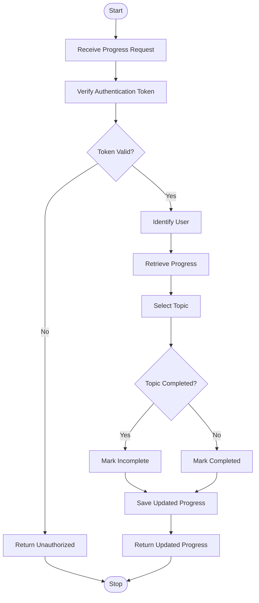
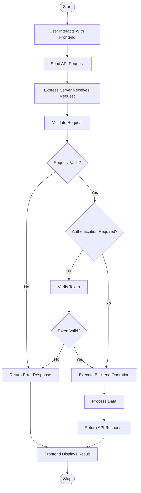

# DSA Hub – Flowcharts

The following diagrams use Mermaid syntax. GitHub automatically renders Mermaid diagrams when this Markdown file is viewed in the repository.

## 1. Overall System Flowchart

## 2. Hash Map Flowchart

## 3. User Registration Flowchart

## 4. User Login Flowchart

## 5. Learning Progress Update Flowchart

## 6. Backend Request Flowchart

